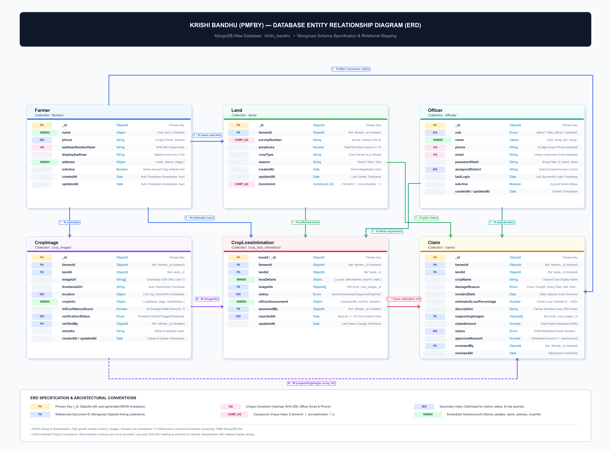

# Krishi Bandhu (PMFBY) — Database Schema & Architecture

> **Database Engine:** MongoDB Atlas (Mongoose ODM v8)  
> **Database Name:** `krishi_bandhu`  
> **Target Compliance:** Pradhan Mantri Fasal Bima Yojana (PMFBY) & UIDAI Data Protection Guidelines

---

## Entity Relationship Diagram (ERD)



---

## Collections Summary

| Collection | Model File | Purpose | Primary Key | Key Foreign References |
|------------|------------|---------|-------------|-------------------------|
| `farmers` | [farmer.model.ts](file:///Users/rohan/pmfby-app/krishi-bandhu/backend/src/models/farmer.model.ts) | Farmer identity, Aadhaar cryptographic hash, personal details, embedded bank accounts & land parcels | `_id` (ObjectId) | None (Root Profile) |
| `lands` | [land.model.ts](file:///Users/rohan/pmfby-app/krishi-bandhu/backend/src/models/land.model.ts) | Surveyed agricultural land parcels, geo-coordinates, crop cultivation & soil attributes | `_id` (ObjectId) | `farmerId` → `farmers._id` |
| `crop_images` | [crop-image.model.ts](file:///Users/rohan/pmfby-app/krishi-bandhu/backend/src/models/crop-image.model.ts) | Geotagged photographic crop evidence with EXIF integrity and PyTorch ML classification | `_id` (ObjectId) | `farmerId` → `farmers._id`, `landId` → `lands._id` |
| `claims` | [claim.model.ts](file:///Users/rohan/pmfby-app/krishi-bandhu/backend/src/models/claim.model.ts) | PMFBY indemnity claims, multi-stage approval state machine, payout records | `_id` (ObjectId) | `farmerId` → `farmers._id`, `landId` → `lands._id`, `reviewedBy` → `officials._id` |
| `crop_loss_intimations` | `crop_loss_repository.dart` | Calamity incident intimation reported within 72h PMFBY window prior to claim adjudication | `_id` (ObjectId) | `farmerId` → `farmers._id`, `landId` → `lands._id`, `imageIds` → `crop_images._id` |
| `officials` | [officer.model.ts](file:///Users/rohan/pmfby-app/krishi-bandhu/backend/src/models/officer.model.ts) | Government agricultural officers, district tenancy, verification credentials & RBAC | `_id` (ObjectId) | None (Staff Directory) |

---

## Detailed Collection Specifications

### 1. `farmers` Collection
*Mongoose Model: `backend/src/models/farmer.model.ts`*

Stores registered farming beneficiaries. In strict adherence to UIDAI regulations, plaintext 12-digit Aadhaar numbers are **never persisted**. A SHA-256 hash (`aadhaarNumberHash`) is enforced as a unique index for deduplication, alongside a masked string (`displayAadhaar`).

```typescript
{
  _id: ObjectId,
  fullName: string,                  // required, trim
  phoneNumber: string,               // required, unique, trim (E.164)
  aadhaarNumberHash: string,         // required, unique (SHA-256)
  displayAadhaar: string,            // "xxxx-xxxx-1234"
  state: string,                     // required, trim
  district: string,                  // required, trim, index
  subDistrict: string,               // optional, trim
  village: string,                   // optional, trim
  pincode: string,                   // optional, trim
  preferredLanguage: string,         // "hi" | "en" | "mr" | "te" | "ta" (default: "hi")
  isPhoneVerified: boolean,          // default: false
  isAadhaarVerified: boolean,        // default: false
  bankDetails: {
    accountNumber: string,
    ifscCode: string,
    bankName: string,
    accountHolderName: string,
    isVerified: boolean
  },
  landParcels: [                     // Embedded land parcel snapshots
    {
      khasraNumber: string,
      areaInHectares: number,
      village: string,
      district: string,
      state: string
    }
  ],
  createdAt: Date,
  updatedAt: Date
}
```

#### Indexes
- `{ phoneNumber: 1 }` (Unique)
- `{ aadhaarNumberHash: 1 }` (Unique)
- `{ district: 1, state: 1 }` (Compound query index)

---

### 2. `lands` Collection
*Mongoose Model: `backend/src/models/land.model.ts`*

Captures survey-level cadastral and agronomic data for individual land parcels owned or leased by the farmer.

```typescript
{
  _id: ObjectId,
  farmerId: ObjectId,                // Ref: 'Farmer', required, index
  khasraNumber: string,              // required, trim
  khataNumber: string,               // optional, trim
  surveyNumber: string,              // optional, trim
  areaInHectares: number,            // required, min: 0.01
  state: string,                     // required, trim
  district: string,                  // required, trim, index
  subDistrict: string,               // optional, trim
  village: string,                   // required, trim
  soilType: string,                  // "Alluvial" | "Black" | "Red" | "Laterite" | ...
  irrigationSource: string,          // "Rainfed" | "Canal" | "Borewell" | "Drip" | ...
  currentCrop: {
    cropName: string,
    cropVariety: string,
    season: "Kharif" | "Rabi" | "Zaid",
    sowingDate: Date,
    harvestDate: Date,
    isInsuredPMFBY: boolean,
    pmfbyPolicyNumber: string
  },
  location: {
    type: "Point",
    coordinates: [longitude, latitude] // GeoJSON
  },
  isVerified: boolean,               // Ground truth verified by Officer
  createdAt: Date,
  updatedAt: Date
}
```

#### Indexes
- `{ farmerId: 1 }`
- `{ district: 1, village: 1 }`
- `{ farmerId: 1, khasraNumber: 1, village: 1 }` (Unique parcel constraint)
- `{ "location": "2dsphere" }` (Spatial geospatial queries)

---

### 3. `crop_images` Collection
*Mongoose Model: `backend/src/models/crop-image.model.ts`*

Stores photographic field evidence captured via the Flutter mobile client. Each upload contains high-entropy SHA-256 hashes and EXIF metadata to prevent fraudulent replays or stock imagery injection.

```typescript
{
  _id: ObjectId,
  farmerId: ObjectId,                // Ref: 'Farmer', required, index
  landId: ObjectId,                  // Ref: 'Land', required, index
  imageUrl: string,                  // Cloudinary CDN Secure URL
  cloudinaryPublicId: string,        // Storage handle
  imageHash: string,                 // SHA-256 hash of raw byte stream (Deduplication)
  captureTimestamp: Date,            // EXIF hardware capture timestamp
  location: {
    type: "Point",
    coordinates: [longitude, latitude], // GPS coordinates from camera
    altitude: number,
    accuracy: number
  },
  cropStage: "Sowing" | "Vegetative" | "Flowering" | "Maturity" | "Harvested",
  mlAnalysis: {
    damageDetected: boolean,
    damagePercentage: number,        // 0.0 - 100.0
    detectedCrop: string,
    healthScore: number,             // 0.0 - 1.0
    confidenceScore: number,         // 0.0 - 1.0
    modelName: string,               // "cropnet-pmfby-v2.4"
    inferenceTimestamp: Date
  },
  status: "pending_review" | "verified" | "flagged" | "rejected",
  createdAt: Date,
  updatedAt: Date
}
```

#### Indexes
- `{ farmerId: 1, createdAt: -1 }`
- `{ landId: 1 }`
- `{ imageHash: 1 }` (Fraud prevention deduplication)
- `{ "location": "2dsphere" }`

---

### 4. `claims` Collection
*Mongoose Model: `backend/src/models/claim.model.ts`*

The core adjudication transaction ledger for PMFBY insurance claims. Enforces a strict finite state machine: `Draft` → `Submitted` → `Under Review` → `Approved` / `Rejected` → `Paid`.

```typescript
{
  _id: ObjectId,
  claimNumber: string,               // Unique human-readable code: "CLM-2026-XXXX"
  farmerId: ObjectId,                // Ref: 'Farmer', required, index
  landId: ObjectId,                  // Ref: 'Land', required, index
  cropSeason: "Kharif" | "Rabi" | "Zaid",
  claimYear: number,                 // e.g., 2026
  claimAmount: number,               // Amount claimed by farmer (INR)
  approvedAmount: number,            // Final settled amount (INR, <= claimAmount)
  calamityType: "Inundation" | "Drought" | "Hailstorm" | "Pest Attack" | "Landslide" | "Cyclone",
  lossDate: Date,
  status: "Draft" | "Submitted" | "Under Review" | "Approved" | "Rejected" | "Paid",
  assignedDistrict: string,          // District routing partition
  evidenceImages: [ObjectId],        // Ref: 'CropImage'
  mlConfidenceScore: number,         // Automated AI baseline score (0.0 - 1.0)
  fieldOfficerReport: {
    officerId: ObjectId,             // Ref: 'Officer'
    inspectionDate: Date,
    verifiedLossPercentage: number,
    groundRemarks: string
  },
  reviewedBy: ObjectId,              // Ref: 'Officer'
  reviewedAt: Date,
  rejectionReason: string,           // Mandatory if status === 'Rejected'
  disbursementDetails: {
    transactionId: string,
    payoutDate: Date,
    pfmsReferenceNumber: string,
    paymentMethod: "DBT_Aadhaar" | "NEFT" | "RTGS"
  },
  createdAt: Date,
  updatedAt: Date
}
```

#### Indexes
- `{ claimNumber: 1 }` (Unique)
- `{ farmerId: 1, status: 1 }`
- `{ assignedDistrict: 1, status: 1 }` (District officer triage queue)
- `{ landId: 1, cropSeason: 1, claimYear: 1 }` (One claim per parcel per season)

---

### 5. `officials` Collection
*Mongoose Model: `backend/src/models/officer.model.ts`*

Government and insurance inspection personnel with district-level isolation, granular RBAC permissions, and cryptographic password hashing (bcrypt).

```typescript
{
  _id: ObjectId,
  email: string,                     // required, unique, lowercase, trim
  passwordHash: string,              // bcrypt cost factor 12
  fullName: string,                  // required, trim
  badgeNumber: string,               // required, unique: "OFF-DL-8821"
  role: "Field_Officer" | "District_Admin" | "State_Auditor" | "Super_Admin",
  assignedState: string,             // required
  assignedDistrict: string,          // required, index
  assignedTaluks: [string],          // Granular geographic jurisdiction
  phoneNumber: string,
  isActive: boolean,                 // default: true
  lastLoginAt: Date,
  createdAt: Date,
  updatedAt: Date
}
```

#### Indexes
- `{ email: 1 }` (Unique)
- `{ badgeNumber: 1 }` (Unique)
- `{ assignedDistrict: 1, role: 1 }`

---

### 6. `crop_loss_intimations` Collection
*Reference: Mobile Repository `crop_loss_repository.dart` & PMFBY 72-Hour Intake API*

Captures immediate farmer distress reports submitted within 72 hours of an adverse climatic event before formal claim submission.

```typescript
{
  _id: ObjectId,
  intimationNumber: string,          // Unique: "INT-2026-XXXX"
  farmerId: ObjectId,                // Ref: 'Farmer', required, index
  landId: ObjectId,                  // Ref: 'Land', required
  calamityType: string,              // Flood, Drought, Hail, Pest
  incidentDate: Date,                // Must be <= 72h prior to intimation
  intimationDate: Date,              // Timestamp of submission
  estimatedLossPercentage: number,   // Self-reported by farmer
  status: "Draft" | "Pending_Inspection" | "Converted_To_Claim" | "Closed",
  associatedClaimId: ObjectId,       // Ref: 'Claim' (set upon conversion)
  imageIds: [ObjectId],              // Ref: 'CropImage'
  createdAt: Date,
  updatedAt: Date
}
```

#### Indexes
- `{ intimationNumber: 1 }` (Unique)
- `{ farmerId: 1, intimationDate: -1 }`
- `{ landId: 1, incidentDate: -1 }`

---

## Architectural Data Integrity Guarantees

1. **UIDAI Aadhaar Shield**: Plaintext Aadhaar is rejected at API validation schemas (`zod` / `Joi`). Only SHA-256 fingerprints are indexed.
2. **Double-Claim Prevention**: A composite unique constraint on `{ landId, cropSeason, claimYear }` prevents multiple payouts for the same parcel in the same agricultural season.
3. **Audit Immutability**: All status transitions (`Draft` → `Submitted` → `Under Review` → `Approved` → `Paid`) are sealed with officer ID and timestamps.
4. **Geospatial Cross-Verification**: GeoJSON coordinates of uploaded `CropImage` are calculated against the `Land` parcel coordinates to verify that the photo was captured directly on-site.
