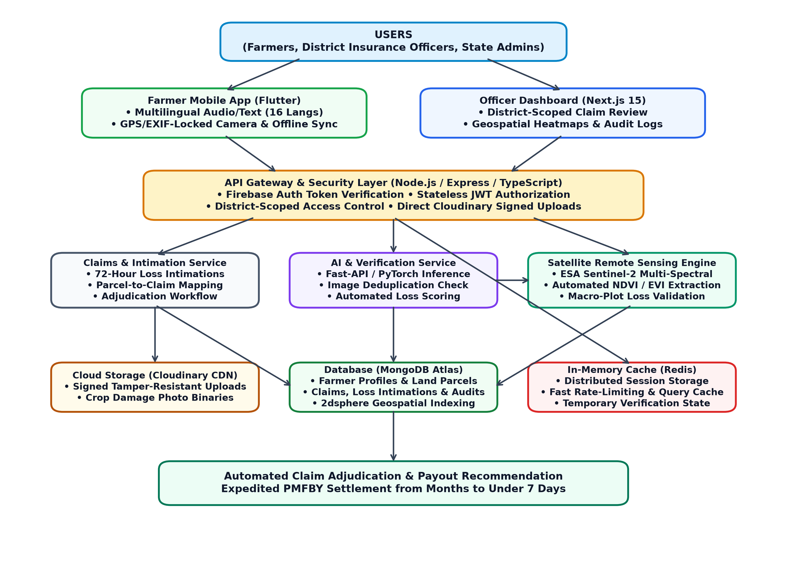
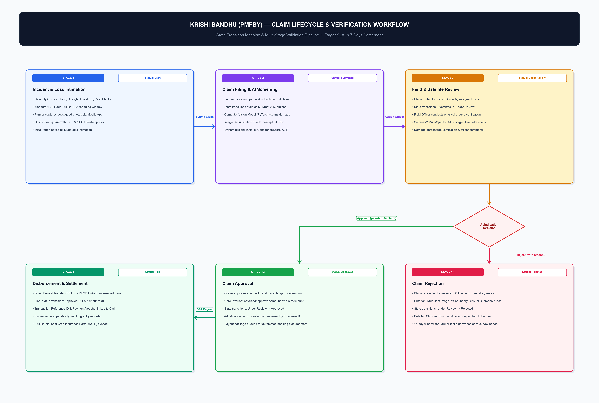
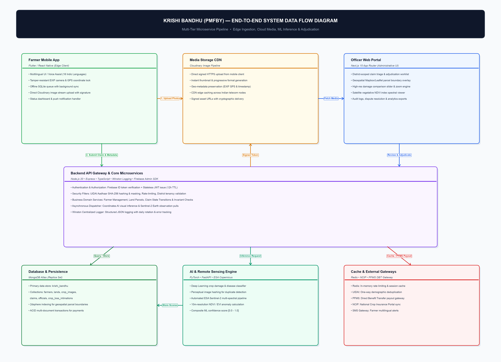
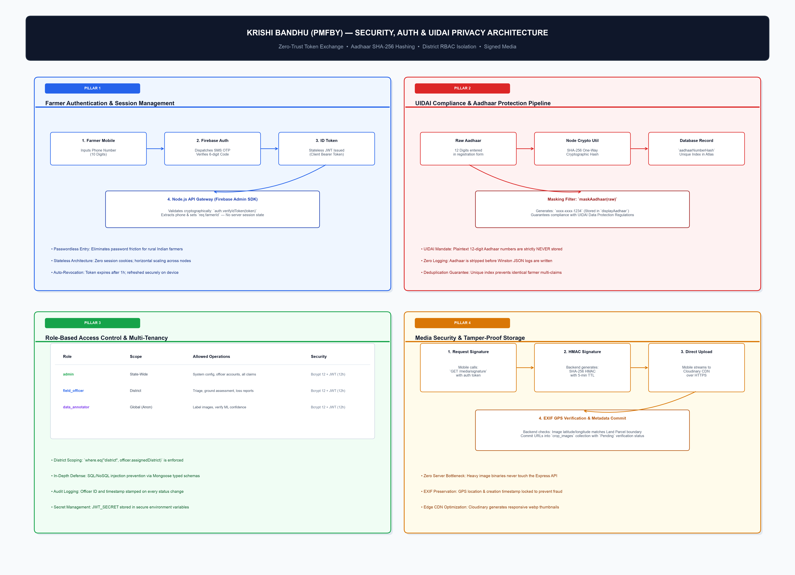
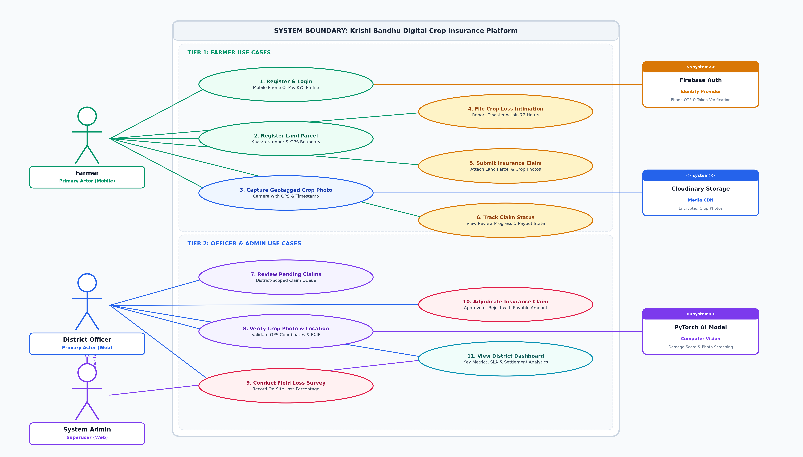

# Krishi Bandhu (PMFBY) — System Architecture & Visual Diagrams

This catalog documents the architectural diagrams, data flows, entity relationships, and security protocols governing the **Krishi Bandhu** PMFBY crop insurance and verification platform.

All diagrams are rendered at 300 DPI high-definition resolution and are stored directly in the [`docs/`](file:///Users/rohan/pmfby-app/krishi-bandhu/docs) directory for documentation and deployment audits.

---

## Table of Contents

1. [High-Level System Architecture](#1-high-level-system-architecture)
2. [Database Entity Relationship Diagram (ERD)](#2-database-entity-relationship-diagram-erd)
3. [PMFBY Claim Lifecycle & State Transition Diagram](#3-pmfby-claim-lifecycle--state-transition-diagram)
4. [End-to-End System Data Flow Diagram (DFD)](#4-end-to-end-system-data-flow-diagram-dfd)
5. [Security, Authentication & UIDAI Aadhaar Privacy Matrix](#5-security-authentication--uidai-aadhaar-privacy-matrix)
6. [UML Use Case Diagram](#6-uml-use-case-diagram)
7. [Regeneration Instructions](#7-regeneration-instructions)

---

## 1. High-Level System Architecture

Visualizes the multi-tier topology connecting the Flutter Android/iOS mobile application, Next.js 15 Web Officer Portal, Express.js backend microservices, MongoDB Atlas, Redis Caching, PyTorch Computer Vision, and External Government APIs (PMFBY NCIP, UIDAI, Bhashini).



### Key Architectural Highlights
- **Client Layer**: Flutter mobile app with offline-first Isar/SQLite storage and Next.js 15 Web Portal for District Agricultural Officers.
- **API & Middleware**: Node.js/TypeScript Express Gateway enforcing JWT Auth, Rate Limiting, RBAC, and Zod schema validation.
- **Persistence Tier**: MongoDB Atlas multi-region cluster with geospatial indexing (`2dsphere`), backed by Redis Cache for hot session states.
- **AI & Satellite Service**: PyTorch image classification service evaluating crop stress percentages, integrated with Copernicus Sentinel-2 satellite NDVI imagery.

---

## 2. Database Entity Relationship Diagram (ERD)

Maps all six core MongoDB collections with primary keys (`_id`), foreign key object references, compound unique indexes, and embedded subdocuments.


### Collections Mapped
- **`farmers`**: Core beneficiary profiles, SHA-256 hashed Aadhaar, embedded bank details, and land parcel summaries.
- **`lands`**: Survey parcel cadastral data, Khasra numbers, geospatial boundary coordinates, and crop insurance coverage status.
- **`crop_images`**: Geotagged photographic crop evidence with cryptographic hash, EXIF timestamp verification, and ML inference scores.
- **`claims`**: PMFBY claim adjudication ledger enforcing state machine constraints (`Draft` → `Submitted` → `Under Review` → `Approved`/`Rejected` → `Paid`).
- **`crop_loss_intimations`**: Immediate 72-hour distress intake queue recorded prior to formal claim filing.
- **`officials`**: Inspection staff directory with district tenancy isolation, bcrypt password hashing, and role hierarchies.

> Comprehensive schema documentation is available in [database-schema.md](file:///Users/rohan/pmfby-app/krishi-bandhu/docs/database-schema.md).

---

## 3. PMFBY Claim Lifecycle & State Transition Diagram

Details the step-by-step state machine transition and SLA gates for crop loss indemnification under PMFBY guidelines (target SLA: < 7 days settlement).



### State Progression
1. **Stage 1: Incident & Loss Intimation (`Draft`)**: Mandatory 72-hour window following flood, hailstorm, drought, or pest attack. Farmer captures offline GPS-stamped images.
2. **Stage 2: Claim Filing & AI Screening (`Submitted`)**: Farmer locks land parcel. PyTorch model screens damage score; perceptual hashing detects duplicated image fraud.
3. **Stage 3: Field & Satellite Review (`Under Review`)**: Claim routed to District Officer by `assignedDistrict`. Officer inspects field on-site; multi-spectral NDVI delta checked via Sentinel-2.
4. **Stage 4: Adjudication Decision**:
   - **Stage 4A: Claim Rejection (`Rejected`)**: Mandatory justification recorded with reason; 15-day appeal window for farmer.
   - **Stage 4B: Claim Approval (`Approved`)**: Approved payable amount sealed (`approvedAmount <= claimAmount`).
5. **Stage 5: Disbursement & Settlement (`Paid`)**: Direct Benefit Transfer (DBT) executed via PFMS to Aadhaar-seeded bank account; state synced with NCIP portal.

---

## 4. End-to-End System Data Flow Diagram (DFD)

Traces the complete lifecycle of telemetry, media packets, and adjudication commands through all system boundaries.



### Data Paths
- **Path 1 (Media Pipeline)**: Camera capture → local EXIF stamp → direct encrypted upload to Cloudinary CDN → secure signed URL and SHA-256 hash returned to API Gateway.
- **Path 2 (AI Inference Pipeline)**: API Gateway dispatches image reference to PyTorch microservice → tensor preprocessing → damage percentage returned in < 800ms.
- **Path 3 (Spatial & Database Persistence)**: Transactions written to MongoDB Atlas with `2dsphere` indexes; hot query results cached in Redis.
- **Path 4 (Officer Triage Stream)**: Next.js Officer Portal fetches pending claims by district tenancy; officers submit digital inspection signatures.

---

## 5. Security, Authentication & UIDAI Aadhaar Privacy Matrix

Illustrates the four defense-in-depth security pillars safeguarding farmer identity, administrative access, and media authenticity.



### Security Pillars
- **Pillar 1: Farmer Authentication**: Firebase Phone Auth with 6-digit OTP over SMS; exchange for short-lived bearer JWT (`exp: 7d`).
- **Pillar 2: UIDAI Aadhaar Privacy Compliance**: Plaintext 12-digit Aadhaar numbers are **never stored**. Client sends Aadhaar; backend computes one-way SHA-256 hash for database uniqueness, storing only masked `xxxx-xxxx-1234` for UI display.
- **Pillar 3: Officer RBAC & District Isolation**: Bcrypt (cost factor 12) authentication. Strict middleware enforcing geographic multi-tenancy (`assignedDistrict == claim.assignedDistrict`).
- **Pillar 4: Signed Cloudinary Media Stream**: Direct-to-Cloudinary uploads authenticated with timestamped HMAC-SHA1 signatures. API Gateway verifies byte integrity before saving to `crop_images`.

---

## 6. UML Use Case Diagram

Synthesizes the core functional model of Krishi Bandhu across primary human actors (Farmers, District Agricultural Officers, System Administrators) and secondary external integration partners (Firebase Auth, Cloudinary Storage, PyTorch AI Engine).



### Core Functional Scope (Streamlined 6+5 Model)
- **Tier 1: Farmer-Facing Services (Flutter Mobile App)**:
  1. **Register & Login**: Mobile phone OTP authentication & Aadhaar KYC profile
  2. **Register Land Parcel**: Khasra cadastral number & GPS parcel boundary
  3. **Capture Geotagged Crop Photo**: AR camera with tamper-proof GPS & timestamp
  4. **File Crop Loss Intimation**: Immediate calamity notification within 72 hours
  5. **Submit Insurance Claim**: Formal PMFBY claim linking land parcel & evidence photos
  6. **Track Claim Status**: End-to-end status tracking and review progress
- **Tier 2: Officer & Admin Governance (Next.js 15 Web Portal)**:
  7. **Review Pending Claims**: District-scoped triage queue for inspection staff
  8. **Verify Crop Photo & Location**: EXIF GPS coordinates vs cadastral land boundary
  9. **Conduct Field Loss Survey**: On-site damage survey & verified loss percentage
  10. **Adjudicate Insurance Claim**: Final approval or rejection with payable amount
  11. **View District Dashboard**: Real-time KPI analytics, SLA tracking & settlement metrics

---

## 7. Regeneration Instructions

All diagrams can be regenerated at any time using their generator scripts:

```bash
# Generate UML Use Case Diagram (300 DPI)
python3 docs/generate_use_case_diagram.py
```

### Dependencies
Requires Python 3 with `matplotlib` and `pillow`:
```bash
pip install matplotlib pillow
```

All diagrams are rendered at 300 DPI directly into [`docs/`](file:///Users/rohan/pmfby-app/krishi-bandhu/docs).
